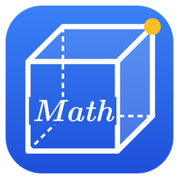

# 도형그리기

수학 수업과 학습지용 **도형 그리기 윈도우 프로그램**입니다.
GSP·지오지브라처럼 점을 움직이면 도형이 함께 바뀌고, 교과서 글씨체(LaTeX)로 그림을 만들어 한글(HWP)·PPT에 바로 붙여 넣을 수 있습니다.

- 현재 버전: **1.9.1**
- 실행 환경: Windows (Python + PySide6)

## 받기

| 파일 | 설명 |
|---|---|
| **[mdraw-setup.exe (설치 파일)](https://github.com/mathkt/mathboard/releases/latest/download/mdraw-setup.exe)** | 실행하면 설치되고 바탕화면·시작 메뉴에 바로가기가 생깁니다. 관리자 권한이 없어도 설치됩니다. 빨리 켜집니다. |
| [mdraw.exe (설치 없이 실행)](https://github.com/mathkt/mathboard/releases/latest/download/mdraw.exe) | 파일 하나만 받아 바로 실행합니다. USB에 넣어 다닐 때 좋습니다. |

- 처음 실행할 때 Windows가 'PC 보호' 경고를 띄우면 **추가 정보 → 실행**을 누르세요. (서명하지 않은 프로그램이라 나오는 안내입니다)
- 새 버전은 새 설치 파일을 그대로 실행하면 덮어서 설치됩니다. 그린 파일(.dhg)은 그대로 열립니다.
- 지난 버전과 바뀐 점: [Releases](https://github.com/mathkt/mathboard/releases)

## 직접 만들어 실행하기 (코드를 고칠 때)

| 방법 | 설명 |
|---|---|
| `exe만들기.bat` 더블클릭 | 필요한 부품을 설치하고 `도형그리기.exe`를 만듭니다. 처음엔 5~10분 걸립니다. 만든 exe 하나만 다른 PC에 복사해도 실행됩니다. |
| `바로실행(파이썬).bat` 더블클릭 | exe를 만들지 않고 바로 실행합니다. (부품이 설치되어 있어야 함) |

처음 한 번은 [Python](https://www.python.org/downloads/)을 설치해야 합니다. 설치 첫 화면의 **"Add python.exe to PATH"** 를 꼭 체크하세요.

## 주요 기능

**평면도형**
- 점, 선분, 직선, 반직선, 다각형, 정다각형, 원, 호·부채꼴
- 길이 표시(중괄호/호, 실선·점선), 각 표시(좁은 각은 직선·곡선 화살표로 바깥에), 같은 길이 눈금, 측정값
- 점 이름·글상자 글꼴, 교과서 수식체(미지수 *x*, *y* 자동 기울임, ° 위첨자)

**작도** — 원래 점을 움직이면 함께 움직입니다
- 중점, 수직이등분선, 각의 이등분선, 수선(수선의 발·직각 표시), 평행선, 교점, 접선
- 길이가 같은 선분 옮기기, 크기가 같은 각 옮기기, 컴퍼스(돌린 만큼 호), 작도 흔적(컴퍼스 호) 표시
- 삼각형 작도(SSS·SAS·ASA), 삼각형의 외심·내심·무게중심·수심

**입체도형**
- 정육면체, 직육면체, 각기둥, 각뿔, 각뿔대, 원기둥, 원뿔, 원뿔대, 구, 반구, 쌓기(회전체)
- 겨냥도·회전(보이지 않는 모서리 자동 점선), 꼭짓점 이름, 겉넓이·부피
- 꼭짓점·모서리·원 둘레·면 위에 점을 찍어 선분·길이·각·수선(실제 3D 길이)
- 면 색칠(Alt+클릭), 자르기(점 3개·방향, 단면 이름·넓이, 벌려 보기), 겹치기(안에 넣기)
- 전개도(펼치는 모양 선택, 접기 애니메이션)

- 꼭짓점 옮기기: 밑면이 정다각형이 아닌 기둥·뿔 (기둥 유지 / 점 하나만)
- 놓는 방향(눕히기): 밑면이 위·오른쪽·왼쪽·앞·뒤를 향하게
- 쌓기: 층마다 원기둥·원뿔·원뿔대·반구 고르기
- 선마다 실선·점선·숨김 (선 고르기)

**편의**
- 그룹 묶기·풀기 (Ctrl+G, Ctrl+Shift+G)
- 도구 창·속성 창 폭 조절, 숨기기 (F3, F4)
- 탭(여러 그림을 한 파일에), 되돌리기, Ctrl+C 하면 한글·PPT에 그림(PNG)으로 바로 붙여넣기 → 한글·PPT 붙여넣기
- 단축키 바꾸기(설정 → 환경 설정 → 단축키), 그린 뒤 자동으로 [선택] 도구

자세한 사용법은 프로그램 안에서 **F1** 또는 `사용법.txt` 를 보세요.

## 파일 구성

| 파일 | 내용 |
|---|---|
| `main.py` | 메인 창, 메뉴, 도구모음, 저장·내보내기 |
| `canvas.py` | 그림판 (마우스 조작, 작도 도구, 컴퍼스) |
| `render.py` | 그리기 (글자, 길이·각 표시, 작도 계산, 입체·전개도 그리기) |
| `panel.py` | 오른쪽 속성 창 |
| `model.py` | 데이터, 저장 형식(.dhg), 길이·각·넓이 계산 |
| `solid.py` | 입체도형 (모양, 숨은 선, 자르기, 쌓기, 전개도, 겉넓이·부피) |
| `installer/` | 설치 파일 설정(Inno Setup)과 설치 화면 그림 |
| `.github/workflows/build-exe.yml` | Releases에서 새 버전을 발행하면 GitHub가 exe를 만들어 붙임 |
| `icon/` | 프로그램 아이콘 (mdraw.ico, mdraw.png) |
| `fonts/` | CMU Serif, KaTeX 수식체 글꼴 (exe 안에 함께 들어감) |

## 라이선스 안내

- 글꼴: CMU Serif, KaTeX_Math — SIL Open Font License 1.1 (`fonts/OFL.txt`)
- 화면 부품: Qt for Python (PySide6) — LGPL v3
